# Deploy (Visual)

Create cluster (Console):

- Kubernetes Engine API: Enable (first time only)
- Open: Kubernetes Engine -> Clusters -> Create -> Standard: Configure

Cluster basics:

- Name: mathora-cluster
- Location type: Zonal
- Zone: australia-southeast1-b

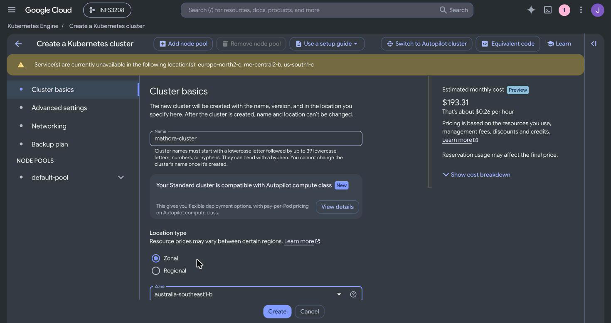

default-pool:

- Number of nodes: 3

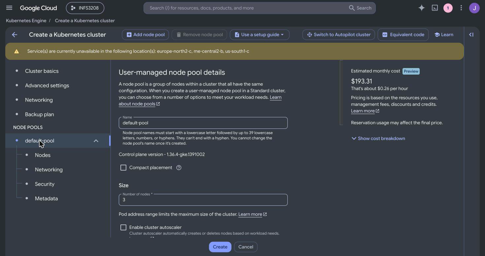

default-pool -> Nodes:

- Image type: Ubuntu with containerd

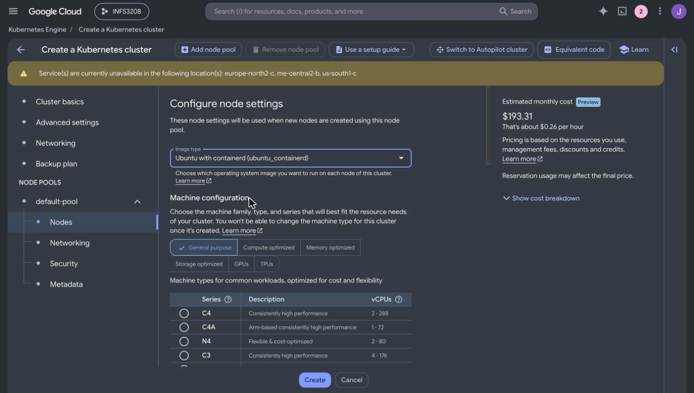

- Series: N1
- Machine type: n1-standard-2
- Boot disk: Balanced persistent disk, 50 GB
- Click: Create

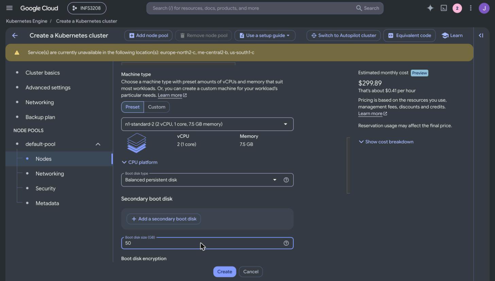

Create repository (Console):

- Open: Artifact Registry -> Repositories -> Create repository
- Name: mathora
- Format: Docker
- Location type: Region, australia-southeast1
- Click: Create

Build (Cloud Shell):

- Open: Cloud Shell (top right)
- Run: Setup and Build from [Deploy](DEPLOY.md)
- Cloud Shell: 10 builds SUCCESS

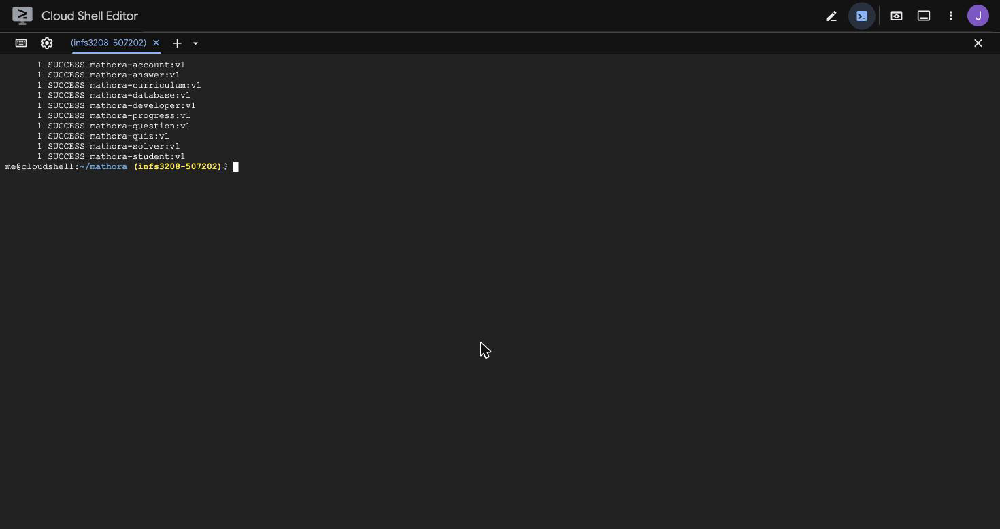

- Artifact Registry -> mathora: 10 images

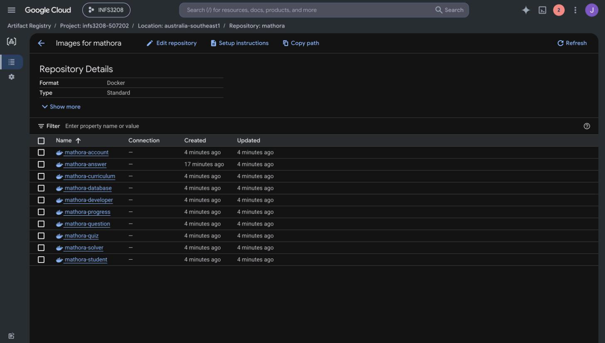

Deploy (Cloud Shell):

- Run: Deploy from [Deploy](DEPLOY.md)
- Kubernetes Engine -> Workloads: all OK

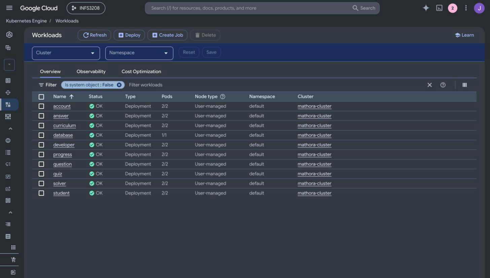

- Kubernetes Engine -> Gateways, Services & Ingress -> Services: student and developer endpoints

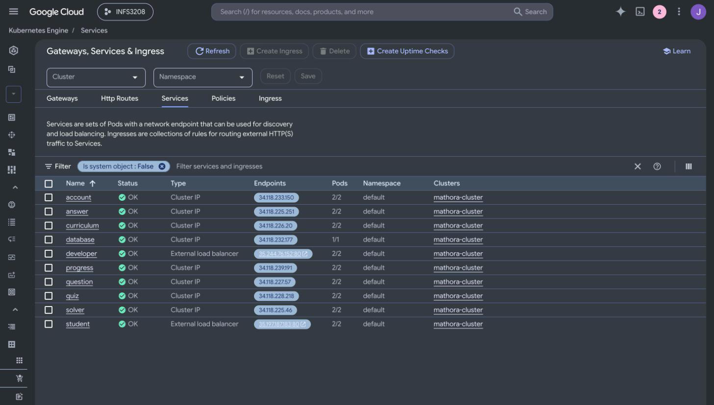

- frontend/student: http://<student_ip>

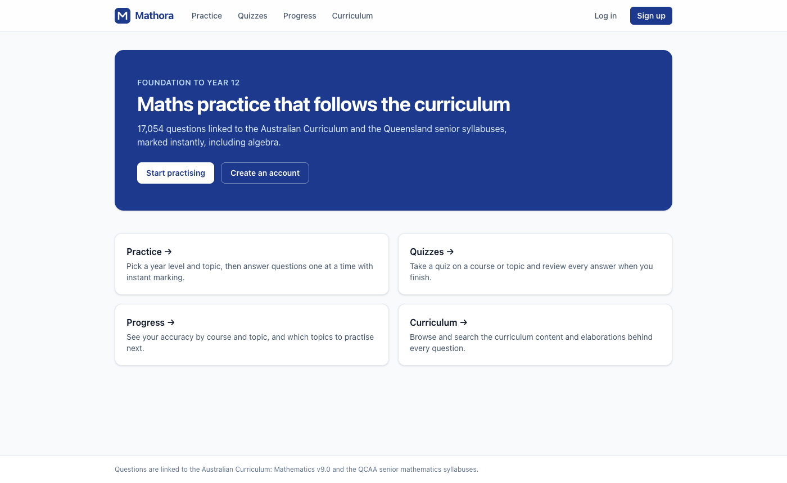

- frontend/developer: http://<developer_ip>

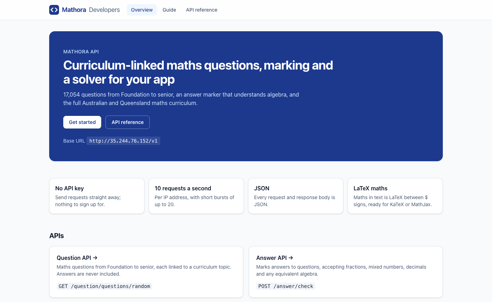

ImagePullBackOff (Console):

- Open: IAM & Admin -> IAM -> Grant access
- Principal: `<project_number>-compute@developer.gserviceaccount.com`
- Role: Artifact Registry Reader
- Delete pod: Workloads -> workload -> Managed pods -> pod -> Delete

Scale (Console):

- Open: Workloads -> quiz -> Actions -> Scale -> Edit replicas
- Replicas: 5

Delete pod (Console):

- Delete: Workloads -> quiz -> Managed pods -> pod -> Delete
- Check: Workloads -> quiz -> Managed pods: new pod replaces it

Load balance (Cloud Shell):

- Run: Load balance from [Deploy](DEPLOY.md)
- Check: different pod names

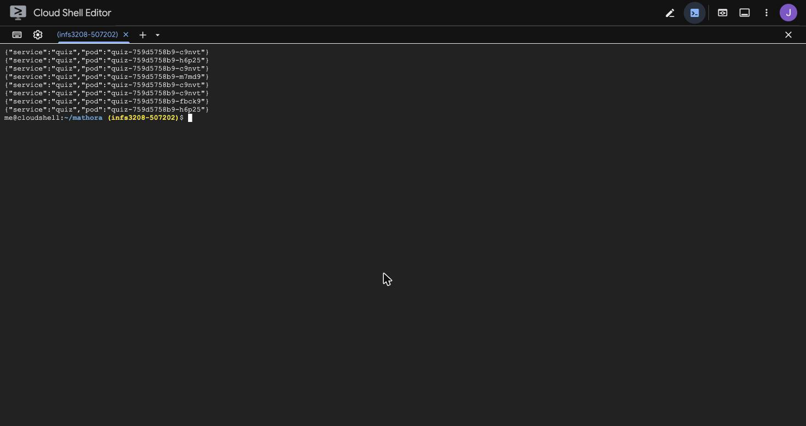

Update (Console):

- Run: Update build (quiz v2) from [Deploy](DEPLOY.md) (Cloud Shell)
- Open: Workloads -> quiz -> Actions -> Rolling update
- Image: `australia-southeast1-docker.pkg.dev/<project_id>/mathora/mathora-quiz:v2`
- Check: Workloads -> quiz -> Revision history: v2

Rollback (Console):

- Open: Workloads -> quiz -> Actions -> Rolling update
- Image: `australia-southeast1-docker.pkg.dev/<project_id>/mathora/mathora-quiz:v1`
- Check: Workloads -> quiz -> Revision history: v1

Pause and resume (Console):

- Open: Clusters -> mathora-cluster -> Nodes -> default-pool -> Resize
- Pause: 0
- Resume: 3
- Note: load balancers and disk still cost while paused

Delete (Console):

- Services: Gateways, Services & Ingress -> student and developer -> Delete
- Storage: Storage -> database -> Delete
- Cluster: Clusters -> mathora-cluster -> Delete
- Repository: Artifact Registry -> Repositories -> mathora -> Delete
