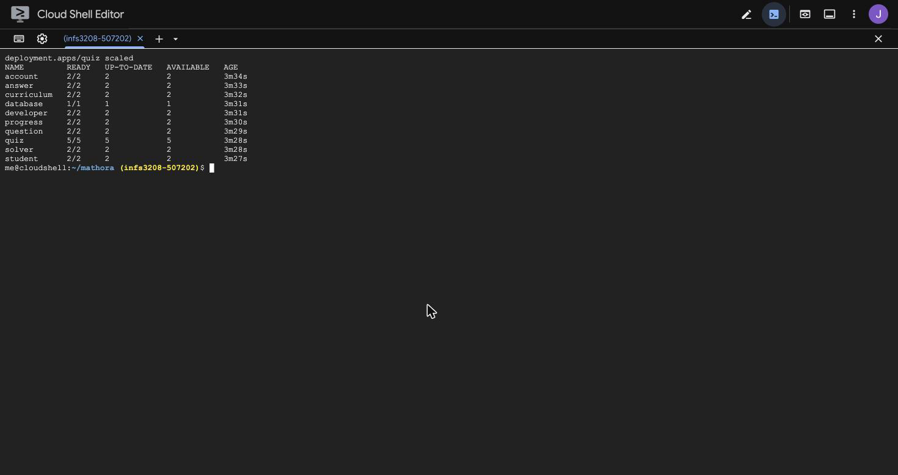
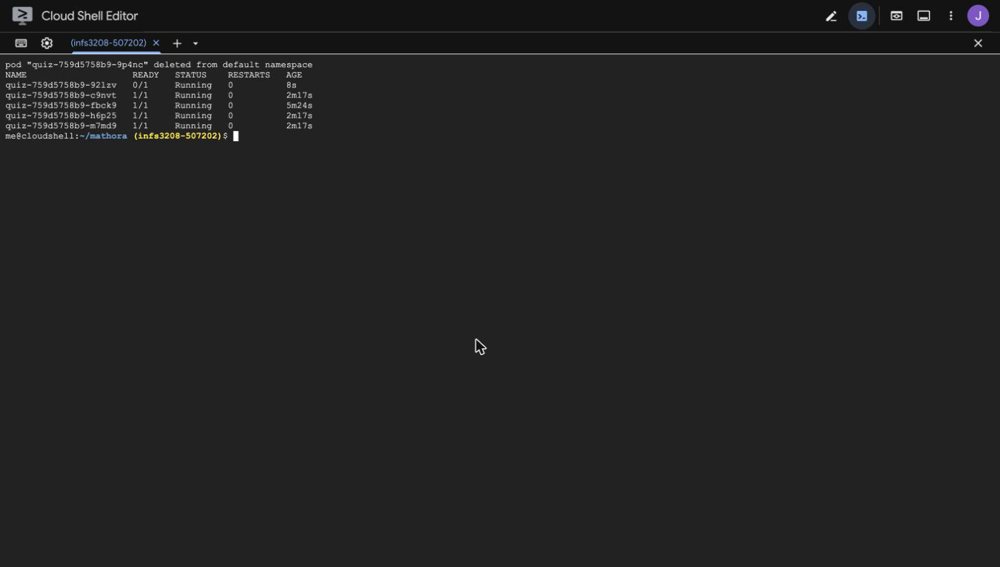
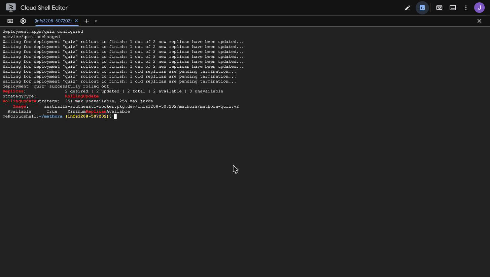
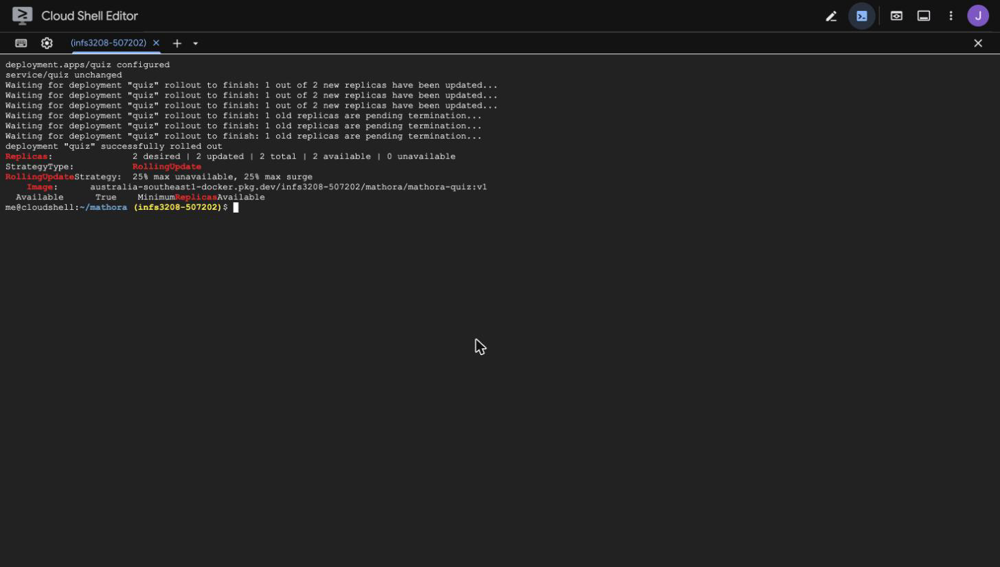
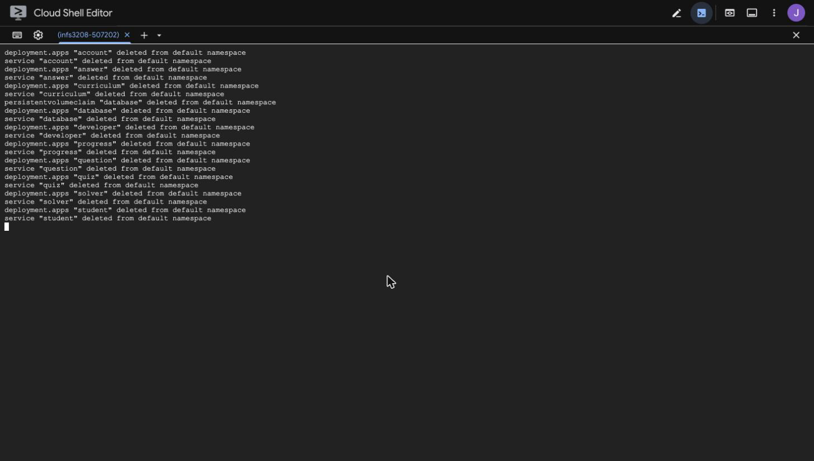

# Deploy

Create cluster (Console):

- Name: mathora-cluster
- Mode: Standard
- Zone: australia-southeast1-b
- Nodes: 3
- Machine: n1-standard-2
- Image: Ubuntu with containerd
- Disk: 50 GB balanced

Create repository (Console):

- Name: mathora
- Format: Docker
- Region: australia-southeast1

Setup (Cloud Shell):

```bash
# Set project
gcloud config set project <project_id>
# Clone repo
git clone https://github.com/jbene445/mathora.git && cd mathora
# Set registry address
export REGISTRY="australia-southeast1-docker.pkg.dev/<project_id>/mathora"
# Turn on Cloud Build
gcloud services enable cloudbuild.googleapis.com
# Let Cloud Build read source and push images
gcloud projects add-iam-policy-binding <project_id> --member=serviceAccount:<project_number>-compute@developer.gserviceaccount.com --role=roles/cloudbuild.builds.builder
```

Build:

```bash
# Build and push image with Cloud Build: --tag name:version, then folder
gcloud builds submit --tag $REGISTRY/mathora-account:v1 backend/account
gcloud builds submit --tag $REGISTRY/mathora-answer:v1 backend/answer
gcloud builds submit --tag $REGISTRY/mathora-curriculum:v1 backend/curriculum
gcloud builds submit --tag $REGISTRY/mathora-progress:v1 backend/progress
gcloud builds submit --tag $REGISTRY/mathora-question:v1 backend/question
gcloud builds submit --tag $REGISTRY/mathora-quiz:v1 backend/quiz
gcloud builds submit --tag $REGISTRY/mathora-solver:v1 backend/solver
gcloud builds submit --tag $REGISTRY/mathora-developer:v1 frontend/developer
gcloud builds submit --tag $REGISTRY/mathora-student:v1 frontend/student
gcloud builds submit --tag $REGISTRY/mathora-database:v1 database
# Use registry images in Kubernetes files
sed -i "s|image: mathora-|image: $REGISTRY/mathora-|" infrastructure/kubernetes/*.yaml
```

Deploy:

```bash
# Connect kubectl to the cluster
gcloud container clusters get-credentials mathora-cluster --zone=australia-southeast1-b
# Create everything in the folder
kubectl apply -f infrastructure/kubernetes/
# Show pods
kubectl get pods
# Show services and EXTERNAL-IP
kubectl get svc
```

- frontend/student: http://<student_ip>
- frontend/developer: http://<developer_ip>

ImagePullBackOff (Console):

- Open: IAM & Admin -> IAM
- Principal: `<project_number>-compute@developer.gserviceaccount.com`
- Role: Artifact Registry Reader

```bash
# Recreate pods to pull images again
kubectl delete pods --all
```

Scale:

```bash
# Scale quiz to 5 pods
kubectl scale deployment quiz --replicas 5
# Show ready pods
kubectl get deployment
```



Delete pod:

```bash
# Delete pod
kubectl delete pod <quiz_pod_name>
# Show replacement pod
kubectl get pods
```



Load balance:

```bash
# Send 8 requests, each shows the pod
for i in {1..8}
do
  curl -s http://<student_ip>/api/quiz/
  echo
done
```

Update:

```bash
# Build and push quiz v2
gcloud builds submit --tag $REGISTRY/mathora-quiz:v2 backend/quiz
# Use v2
sed -i "s|mathora-quiz:v1|mathora-quiz:v2|" infrastructure/kubernetes/quiz.yaml
# Rolling update
kubectl apply -f infrastructure/kubernetes/quiz.yaml
# Show image
kubectl describe deployment quiz
```



Rollback:

```bash
# Use v1
sed -i "s|mathora-quiz:v2|mathora-quiz:v1|" infrastructure/kubernetes/quiz.yaml
# Rollback
kubectl apply -f infrastructure/kubernetes/quiz.yaml
```



Pause:

```bash
# Resize to 0 nodes
gcloud container clusters resize mathora-cluster --num-nodes=0 --zone australia-southeast1-b
```

Resume:

```bash
# Resize to 3 nodes
gcloud container clusters resize mathora-cluster --num-nodes=3 --zone australia-southeast1-b
```

Delete:

```bash
# Delete everything in the folder
kubectl delete -f infrastructure/kubernetes/
```



Delete (Console):

- Cluster: mathora-cluster
- Repository: mathora
